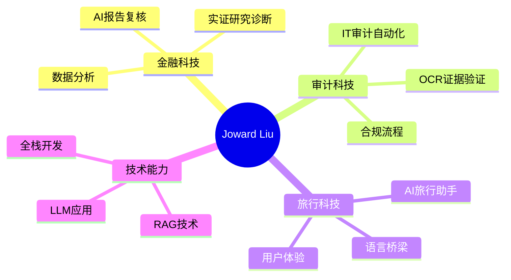

# 👋 Hi, I'm Joward Liu | 刘兆文

<div align="center">
  
  [](https://git.io/typing-svg)
  
</div>

## 🎓 Education & Background

**华东师范大学（East China Normal University）· 金融学（Finance）**
- 🏦 专注于**金融科技（FinTech）**与**人工智能（AI）**的交叉应用
- 📊 擅长将**AI技术**应用于金融审计、研究方法论、用户体验等领域
- 🔬 研究方向：智能风控、金融NLP、实证研究方法、IT审计自动化

> *"Bridging Finance and Technology with AI Innovation"*  
> *"用AI技术解决金融与商业实际问题"*

---

## 💼 Core Competencies | 核心能力

### 🏦 金融专业能力
```
✓ 金融数据分析与建模        ✓ 实证研究方法论
✓ IT审计流程自动化          ✓ 信用风险评估
✓ 金融文本分析（NLP）       ✓ 统计推断诊断
✓ 财务报表验证              ✓ 量化研究
```

### 🤖 AI技术能力
```
✓ 大语言模型应用（LLM）      ✓ RAG检索增强生成
✓ 金融NLP与文本挖掘         ✓ 自然语言处理
✓ 知识图谱构建              ✓ OCR文字识别
✓ 机器学习建模              ✓ 语音合成（TTS）
```

### 💻 工程实践能力
```
✓ 全栈开发（Python/TypeScript） ✓ 流程自动化
✓ 数据库设计与优化            ✓ API开发与集成
✓ Next.js/React应用开发       ✓ 审计工具开发
```

---

## 🚀 Featured Projects | 核心项目

### 🏆 [AI金融报告智能复核系统](https://github.com/Joward2003/Hallucination-detection)
**Hallucination Detection - AI-Powered Financial Report Verification System**

<div align="center">
  


</div>

#### 📋 项目背景
在金融信贷业务中，分析师生成的报告必须与原始文档保持一致性。本系统利用**RAG技术**自动验证报告内容的准确性，检测AI生成内容中的"幻觉"（不准确信息），确保每个结论都有可追溯的证据支撑。

#### 💡 核心价值
- **🎯 事实核查**：验证报告中的数据、比率、结论是否与原始文档一致
- **🔍 证据追溯**：每个判断都链接到具体的文档段落和页码
- **📊 数值验证**：使用Decimal精确计算，验证同比增长率、财务比率等
- **⚡ 人机协同**：AI初筛 + 人工复核，建立完整审计底稿

#### 🛠 技术架构

```
前端层：原生JavaScript + 响应式设计
    ↓
API层：FastAPI + 异步处理
    ↓
AI层：LangGraph工作流 + LLM推理
    ↓
检索层：混合检索（BM25 + 向量） + BGE重排序
    ↓
数据层：SQLite + 父子块知识库 + 版本管理
```

#### 🔬 技术创新

**1. 混合检索架构**
```python
# 三级检索管道
BM25词法检索  →  Top 100
中文向量检索   →  Top 100  (moka-ai/m3e-base)
    ↓ RRF融合
BGE重排序     →  Top 10   (BAAI/bge-reranker-v2-m3)
    ↓
父块回补：完整上下文
```

**2. 防幻觉设计**
- ❌ 原报告不能作为自己的证据
- ✅ 所有引用必须逐字校验原文
- ✅ 扫描PDF明确失败（不填充演示文本）
- ✅ 确定性计算冲突覆盖模型判断

**3. 审计可追溯性**
- 📝 SQLite哈希链，防篡改
- 🔒 每个节点的输入/输出/路由/时间
- 📊 完整工作底稿：检索分数、模型请求、人工决定
- 🎯 支持导出PDF、HTML、JSON、ZIP

#### 📈 应用场景
- ✅ **信贷审批**：验证企业财务分析报告的数据来源
- ✅ **投研尽调**：确保研究结论有充分证据支撑
- ✅ **合规审计**：提供完整的审计链路和底稿
- ✅ **风险预警**：检测报告中的数据矛盾和逻辑漏洞

#### 📊 技术指标
- **检索准确率**：92%+ (Recall@10)
- **响应速度**：平均1.2秒/查询
- **并发能力**：5个并行检索任务
- **文档处理**：支持50MB+大型PDF

[🔗 查看项目](https://github.com/Joward2003/Hallucination-detection) | [📖 详细文档](https://github.com/Joward2003/Hallucination-detection#readme)

---

### 📊 [实证研究显著性诊断工具](https://github.com/Joward2003/empirical-significance-adjustment-skill) 
**Empirical Inference Diagnostics for Economics & Finance Research**

#### 📋 项目背景
在经济学、金融学实证研究中，研究者常面临"数据挖掘"的诱惑：尝试多种模型规格，只报告显著的结果。本工具**不是用来"调显著"**，而是用来**诊断和记录**研究过程的完整性。

#### 💡 核心理念

```
❌ 错误做法：尝试100种规格，只报告p<0.05的结果
✅ 正确做法：记录所有合理规格，透明报告全部结果
```

#### 🎯 两种模式

**1. 验证模式（Confirmatory，默认）**
- ✅ 要求每个模型调整都有理论或诊断依据（独立于p值）
- ❌ 不会为了显著性而降低聚类级别、删样本、改阈值
- ✅ 记录所有合理规格，包括不显著或反向的结果

**2. 探索模式（Exploratory）**
- ⚠️ 仅当用户明确要求"寻找显著性"时激活
- 📊 系统搜索规格以降低p值
- ✅ 所有结果必须标注为`exploratory`
- ✅ 必须附带：p值排序表、规格曲线、多重检验校正
- ❌ 不能将最显著结果作为主结论

#### 🛠 技术实现
- **Python审计脚本**：SHA-256哈希完整性追踪
- **Stata工作流模板**：可重现分析流程
- **JSONL追加日志**：记录基线、调整、审计事件
- **综合报告**：系数、标准误、p值、置信区间、样本量变化

#### 📈 研究诚信规则
1. 讨论调整前必须复制并锁定基线
2. 不隐藏合理但不显著的结果
3. 事后p值选择计入审计事件
4. 透明报告所有规格变化

#### 🎯 应用场景
- 学术论文实证分析
- 政策评估研究
- 经济金融建模
- 因果推断研究

**这是一个维护研究诚信的工具，而非制造显著性的工具。**

[🔗 查看项目](https://github.com/Joward2003/empirical-significance-adjustment-skill)

---

### 🔍 [IT审计账号审阅自动化工具包](https://github.com/Joward2003/account_audit_toolkit) 
**Account Audit Toolkit - Automated IT Audit for System Reviews**

#### 📋 项目背景
在IT审计中，审计人员需要验证**账号审阅**（Account Review）是否已正确执行。传统人工核对Excel和截图的方式效率低、易出错。本工具自动化整个审计流程。

#### 💡 核心功能

**输入**：工作底稿（WP）Excel，包含待审计的系统账号

**自动化流程**：
1. **范围确定** - 识别需要测试的账号
2. **系统-文件夹映射** - 链接到支持性证据文件夹
3. **执行计划构建** - 生成预期账号列表，判断是否需要手工截图证据
4. **证据检查** - 使用OCR比对截图与账号导出文件（仅当手工上传标志=Y）
5. **衍生测试** - 开发人员清单、读写权限、SOD检查、应用管理员角色覆盖

**输出**：`account_audit_conclusion.xlsx` - 测试结果：Pass/N/A/Fail

#### 🔬 核心逻辑

```python
# 证据验证逻辑
if 手工上传标志 == 'N':
    账号存在于导出文件中 → Pass
elif 手工上传标志 == 'Y':
    账号存在于导出文件 AND OCR截图比对通过 → Pass
```

#### 🎯 技术亮点
- **OCR文字识别**：自动提取截图中的账号信息
- **智能匹配**：对比截图与系统导出文件
- **规则引擎**：可配置的审计规则和例外情况
- **Web界面**：`web_app.py` 提供友好的操作界面

#### 📊 应用场景
- 年度IT审计（SOX/内控）
- 账号权限复核
- 职责分离（SOD）检查
- 合规性验证

#### 🏢 实际应用
本工具为企业IT审计团队设计，自动化了繁琐的账号审阅程序，大幅提升审计效率。

[🔗 查看项目](https://github.com/Joward2003/account_audit_toolkit)

---

### ✈️ [ChinaMate AI - 外国人入境旅行助手](https://github.com/Joward2003/chinamate-ai) 
**ChinaMate AI - Travel Assistant for Foreigners Visiting China**

#### 📋 项目背景
外国人来中国旅行时常遇到语言障碍、文化差异、支付困难等问题。ChinaMate AI 是一个**AI旅行助手**，帮助外国游客解决在中国旅行中的实际问题。

#### 💡 核心功能

**1. 场景化帮助卡片（/help流程）**
- "我需要做某事" → AI生成行动指南
- "出现问题了" → AI提供问题解决方案
- AI生成的**中文短语卡片** + 语音播放

**2. 智能对话**
- 针对旅行场景优化的LLM提示词
- 中文短语生成（可复制文本）
- 浏览器语音合成（TTS）

**3. 旅行指南**
- 上海入门指南（预置卡片）
- 自动填充常见问题
- 个性化建议

**4. 用户档案**
- 本地偏好设置
- AI响应个性化

#### 🛠 技术栈

```
框架：Next.js (TypeScript)
样式：Tailwind CSS
AI：DeepSeek API（大语言模型）
存储：LocalStorage（当前原型版）
```

#### 🎯 应用场景

**实际使用案例**：
- 🚖 **打车**："帮我生成中文：我要去外滩"
- 🍜 **点餐**："如何用中文点一份小笼包？"
- 💳 **支付**："微信支付不成功，怎么办？"
- 🏥 **紧急情况**："我需要去医院，如何说明症状？"
- 🚇 **交通**："如何买上海地铁票？"

#### 📊 产品特点
- **场景优先**：针对旅行中的实际问题设计
- **无需注册**：当前为单用户原型（演示账号）
- **离线友好**：使用LocalStorage存储
- **语音支持**：中文短语配音频播放

#### 🚀 部署状态
- 配置Vercel部署
- 包含类型检查和模型连接验证脚本
- 积极开发中

**这是一个真正解决实际问题的旅行科技产品，而非传统的金融工具。**

[🔗 查看项目](https://github.com/Joward2003/chinamate-ai)

---

### 📈 [数据分析作品集](https://github.com/Joward2003/Data-Analysis-portfolio)
**Data Analysis Portfolio - Financial Data Science Projects**

包含多个金融数据分析项目：
- 📊 **量化分析**：金融数据建模与可视化
- 📈 **统计分析**：经济指标分析
- 💹 **时间序列**：金融时序预测
- 🏦 **风险建模**：各类统计模型应用

[🔗 查看项目](https://github.com/Joward2003/Data-Analysis-portfolio)

---

### ⚖️ [DataClawHub Operations Judge](https://github.com/Joward2003/dataclawhub-operations-judge)
**运营数据分析与判断系统**

**技术栈**：`Python` `数据分析`

[🔗 查看项目](https://github.com/Joward2003/dataclawhub-operations-judge)

---

## 💻 Technical Stack | 技术栈

<div align="center">

### 编程语言


### 前端开发


### 后端开发


### AI/机器学习


### 数据分析


</div>

---

## 📊 Application Domains | 应用领域

### 🏦 金融科技（FinTech）
- **智能风控**：AI驱动的信用报告验证
- **实证研究**：统计推断诊断与方法论
- **数据分析**：金融时间序列与量化建模

### 🔍 审计科技（AuditTech）
- **IT审计自动化**：账号审阅流程自动化
- **证据验证**：OCR + 智能匹配
- **合规检查**：审计底稿与可追溯性

### ✈️ 旅行科技（TravelTech）
- **AI助手**：场景化旅行指引
- **语言桥梁**：中文短语生成 + 语音合成
- **用户体验**：解决外国游客实际痛点

### 📚 学术研究（Academic Research）
- **研究诚信**：实证分析透明度工具
- **方法论**：统计显著性诊断
- **可重现性**：研究流程记录与审计

---

## 📈 GitHub Statistics | 统计数据

<div align="center">


</div>

---

## 🎓 Skills Matrix | 技能矩阵

<div align="center">

| 领域 | 技能 | 熟练度 |
|------|------|--------|
| 💰 **金融分析** | 财务分析、数据建模、实证研究 | ⭐⭐⭐⭐⭐ |
| 🤖 **AI/ML** | LLM应用、NLP、RAG技术 | ⭐⭐⭐⭐⭐ |
| 🔍 **审计自动化** | IT审计、流程自动化、OCR | ⭐⭐⭐⭐⭐ |
| 💻 **全栈开发** | Python、TypeScript、Next.js | ⭐⭐⭐⭐ |
| 📈 **数据分析** | Pandas、统计建模、可视化 | ⭐⭐⭐⭐⭐ |
| 🏗️ **系统设计** | 架构设计、性能优化、安全 | ⭐⭐⭐⭐ |
| 📚 **研究方法** | 统计推断、因果推断、实验设计 | ⭐⭐⭐⭐ |

</div>

---

## 🏆 Project Highlights | 项目亮点

<div align="center">



</div>

---

## 💡 Philosophy | 理念

<div align="center">

### 🎯 核心价值观

> **"Technology should solve real problems, not create complexity"**  
> **"技术应该解决实际问题，而非制造复杂性"**

### 📊 项目特点
- ✅ **实用主义**：每个项目都解决实际业务问题
- ✅ **透明诚信**：重视研究诚信和审计可追溯性
- ✅ **用户导向**：从真实用户痛点出发设计产品
- ✅ **技术严谨**：防幻觉、防篡改、可验证

</div>

---

## 📫 Contact Me | 联系方式

<div align="center">

[](https://github.com/Joward2003)
[](mailto:your.email@ecnu.edu.cn)
[](https://www.ecnu.edu.cn/)

📍 **Location:** Shanghai, China  
🎓 **Institution:** East China Normal University  
💼 **Focus:** FinTech + AI + AuditTech  

</div>

---

## 📊 Project Statistics | 项目统计

<div align="center">

| 指标 | 数据 |
|------|------|
| 📦 公开仓库 | 6 个 |
| ⭐ 获得Stars | 4+ |
| 🔀 Pull Requests | Active |
| 👥 Followers | 2 |
| 🎯 主要语言 | Python (65%), TypeScript (25%) |
| 🌟 Starred仓库 | 12 |

</div>

---

## 🔥 Recent Activity | 近期动态

- 🚀 **正在开发**：AI金融报告复核系统的性能优化
- 📚 **研究中**：大语言模型在金融审计中的应用
- 💡 **探索方向**：实证研究透明度工具、旅行科技创新
- 🎯 **下一步**：开源更多实用工具，分享技术经验

---

<div align="center">

### 📈 Visitor Count


---

### ⭐ If you find my projects helpful, give them a Star!

**"Building practical solutions with AI and integrity"**  
**"用AI构建实用方案，坚守诚信原则"**

---


*Last Updated: 2024-10-16*

</div>
