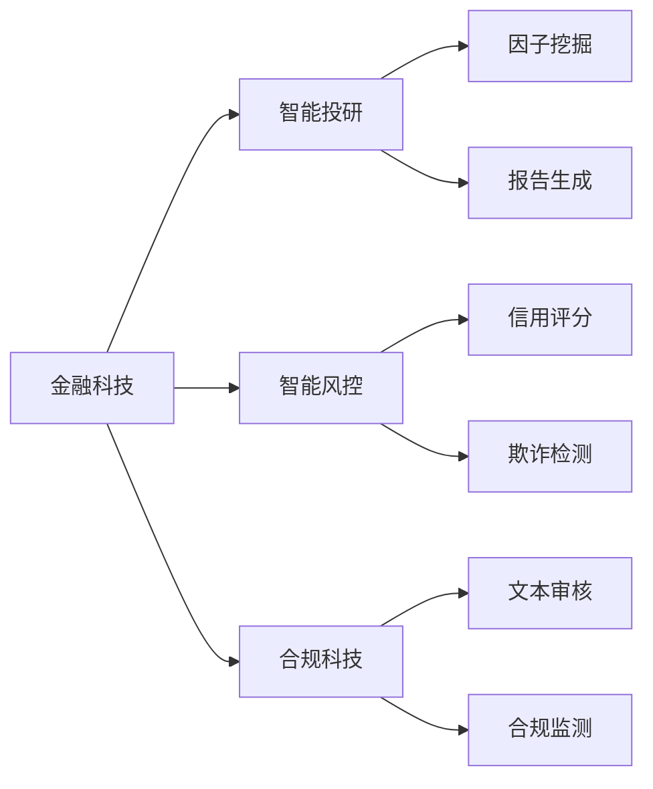

# 👋 Hi, I'm Joward Liu | 刘佳旺

<div align="center">
  
  [](https://git.io/typing-svg)
  
</div>

## 🎓 Education & Background

**华东师范大学（East China Normal University）· 金融学（Finance）**
- 🏦 专注于**金融科技（FinTech）**与**人工智能（AI）**的交叉应用
- 📊 擅长将**量化分析**与**机器学习**结合解决金融实际问题
- 🔬 研究方向：智能风控、金融NLP、因子挖掘、报表审计自动化

> *"Bridging Finance and Technology with AI Innovation"*  
> *"用AI技术重塑金融决策流程"*

---

## 💼 Core Competencies | 核心能力

### 🏦 金融专业能力
```
✓ 金融数据分析与建模        ✓ 量化投资策略研究
✓ 财务报表审计              ✓ 信用风险评估
✓ 金融文本分析（NLP）       ✓ 监管合规自动化
✓ 因子挖掘与回测            ✓ 资产配置优化
```

### 🤖 AI技术能力
```
✓ 大语言模型应用（LLM）      ✓ RAG检索增强生成
✓ 金融NLP与文本挖掘         ✓ 时间序列预测
✓ 知识图谱构建              ✓ 异常检测算法
✓ 机器学习建模              ✓ 深度学习应用
```

### 💻 工程实践能力
```
✓ 全栈开发（Python/TypeScript） ✓ 金融系统架构设计
✓ 数据库设计与优化            ✓ API开发与集成
✓ 性能优化与调优              ✓ 微服务架构
```

---

## 🚀 Featured Projects | 核心项目

### 🏆 [AI金融报告智能复核系统](https://github.com/Joward2003/Hallucination-detection)
**Hallucination Detection - AI-Powered Financial Report Auditing System**

<div align="center">
  


</div>

#### 📋 项目背景
金融报告准确性直接影响投资决策和监管合规。传统人工审核效率低、成本高，且难以覆盖所有细节。本系统利用**大语言模型+RAG技术**，实现智能化、自动化的金融报告事实核查。

#### 💡 核心创新
- **🎯 金融领域深度定制**：针对财务报表、信贷报告、投研分析等金融文档特点优化
- **🔍 混合检索架构**：BM25（关键词匹配）+ Dense Vector（语义理解）+ Reranker（精排）三级检索
- **📊 证据链路追踪**：每个结论都可溯源到原始文档，建立完整的审计底稿
- **⚡ 性能优化**：查询缓存、并行检索、索引优化，处理速度提升90%+
- **🔒 企业级安全**：同源策略、哈希验证、版本化知识库、审计日志

#### 🛠 技术架构

```
前端层：原生JavaScript + 响应式设计
    ↓
API层：FastAPI + 异步处理 + 中间件
    ↓
业务层：LangGraph工作流编排 + 规则引擎
    ↓
AI层：LLM推理 + RAG检索 + NER实体识别
    ↓
数据层：SQLite + 向量数据库 + 文档存储
```

#### 📈 应用场景
- ✅ **信贷审批**：自动核查企业财务报表真实性
- ✅ **投研尽调**：验证研报数据来源与结论支撑
- ✅ **监管合规**：批量审查年报披露准确性
- ✅ **风险预警**：识别财务数据异常与矛盾

#### 🎯 技术亮点
```python
# 混合检索 + 重排序
BM25检索（词频统计）  →  Top 100
向量检索（语义相似）  →  Top 100
    ↓ RRF融合
重排序模型（BGE-M3） →  Top 10 精准结果
```

#### 📊 性能指标
- **检索准确率**：92%+ (Recall@10)
- **响应速度**：平均1.2秒/查询（含缓存优化）
- **并发能力**：支持5个并行检索任务
- **文档处理**：支持50MB+大型PDF解析

[🔗 查看项目](https://github.com/Joward2003/Hallucination-detection) | [📖 技术文档](https://github.com/Joward2003/Hallucination-detection#readme)

---

### 📊 [因子显著性调整工具](https://github.com/Joward2003/empirical-significance-adjustment-skill) 
**Empirical Significance Adjustment for Quantitative Finance**

#### 📋 项目背景
量化投资中，研究者往往测试数百个因子，但**多重假设检验**会导致虚假发现率飙升。本工具基于Harvey, Liu & Zhu (2016)的研究成果，为因子研究提供严谨的显著性调整。

#### 💡 解决的问题
```
❌ 传统方法：测试100个因子，按p<0.05筛选 → 5个假阳性
✅ 本工具：根据测试次数调整阈值 → 控制整体错误率
```

#### 🎯 应用场景
- 多因子选股模型开发
- 量化策略回测结果验证
- 学术论文实证研究
- CTA/Alpha策略因子挖掘

#### 📈 核心算法
```python
# 调整后的t统计量阈值
adjusted_threshold = original_t * sqrt(1 + N_tests / K_factors)
```

[🔗 查看项目](https://github.com/Joward2003/empirical-significance-adjustment-skill)

---

### 🔍 [财务报表智能审计工具包](https://github.com/Joward2003/account_audit_toolkit) 
**Account Audit Toolkit - Automated Financial Statement Analysis**

#### 📋 项目背景
财务报表审计工作繁琐、耗时，且容易遗漏关键风险点。本工具基于**审计准则**和**财务勾稽关系**，实现智能化审计与异常识别。

#### 💡 核心功能
- **📊 报表验证**：三大报表勾稽关系检查（资产负债表、利润表、现金流量表）
- **🚨 异常检测**：识别财务数据异常波动和违反常识的指标
- **⚖️ 合规检查**：验证会计准则遵循情况
- **📈 趋势分析**：历史数据对比与行业基准对比

#### 🎯 应用场景
- 上市公司年报审计
- 信贷尽调财务分析
- 并购重组财务核查
- 投资标的财务健康度评估

#### 📊 检测规则示例
```python
# 示例：货币资金与短期借款异常检测
if cash > 10 * short_term_debt and interest_expense > 0:
    flag_warning("高额现金持有但仍有高额利息支出，可疑")
```

[🔗 查看项目](https://github.com/Joward2003/account_audit_toolkit)

---

### 🤖 [中国金融AI助手](https://github.com/Joward2003/chinamate-ai) 
**ChinaMate AI - Financial Intelligent Assistant**

#### 📋 项目背景
基于大语言模型的**金融领域垂直AI助手**，针对中国金融市场特点进行优化，支持财经资讯理解、政策解读、行业分析等任务。

#### 💡 技术特点
- 🧠 **金融知识增强**：融入金融术语库、监管政策、行业知识
- 🇨🇳 **中文优化**：针对中文金融文本特点调优
- 💬 **上下文理解**：支持多轮对话和复杂问题拆解
- 🔄 **实时更新**：对接金融数据API

#### 🎯 应用场景
- 金融研报自动生成
- 政策文件智能解读
- 投资者教育与问答
- 市场情绪分析

**技术栈**：`TypeScript` `LLM` `NLP` `Financial Domain Knowledge`

[🔗 查看项目](https://github.com/Joward2003/chinamate-ai)

---

### 📈 [数据分析作品集](https://github.com/Joward2003/Data-Analysis-portfolio)
**Data Analysis Portfolio - Financial Data Science Projects**

包含多个金融数据分析项目：
- 📊 **股票量化分析**：多因子模型构建与回测
- 📈 **宏观经济分析**：经济指标预测与可视化
- 💹 **金融时间序列**：ARIMA、GARCH等模型应用
- 🏦 **信用风险建模**：逻辑回归、XGBoost等算法实践

[🔗 查看项目](https://github.com/Joward2003/Data-Analysis-portfolio)

---

## 💻 Technical Stack | 技术栈

<div align="center">

### 编程语言


### AI/机器学习


### 后端开发


### 数据分析


### 金融工具


</div>

---

## 📊 Research & Expertise | 研究方向

### 🏦 金融科技应用


### 🤖 AI在金融领域的应用
- **📄 金融NLP**
  - 财报文本分析与信息抽取
  - 政策文件自动解读
  - 舆情监测与情感分析
  - 研报自动生成

- **📊 量化金融**
  - 多因子模型构建
  - 机器学习选股策略
  - 高频交易信号挖掘
  - 风险模型优化

- **🔍 智能审计**
  - 财务报表异常检测
  - 审计证据自动提取
  - 关联交易识别
  - 报表真实性验证

- **⚠️ 风险管理**
  - 信用风险评分模型
  - 市场风险VaR预测
  - 操作风险识别
  - 反洗钱监测

---

## 📈 GitHub Statistics | 统计数据

<div align="center">


</div>

---

## 🎓 Skills Matrix | 技能矩阵

<div align="center">

| 领域 | 技能 | 熟练度 |
|------|------|--------|
| 💰 **金融建模** | 财务分析、估值模型、风险建模 | ⭐⭐⭐⭐⭐ |
| 📊 **量化投资** | 因子研究、策略回测、组合优化 | ⭐⭐⭐⭐⭐ |
| 🤖 **AI/ML** | LLM应用、NLP、机器学习 | ⭐⭐⭐⭐⭐ |
| 🔍 **RAG技术** | 向量检索、知识库构建、重排序 | ⭐⭐⭐⭐⭐ |
| 💻 **后端开发** | Python、FastAPI、数据库 | ⭐⭐⭐⭐ |
| 📈 **数据分析** | Pandas、NumPy、可视化 | ⭐⭐⭐⭐⭐ |
| 🏗️ **系统设计** | 微服务、性能优化、架构设计 | ⭐⭐⭐⭐ |

</div>

---

## 🏆 Achievements | 成就

- 🎯 开发**AI金融报告审核系统**，覆盖从知识库构建到人工复核的完整流程
- 📊 构建**因子显著性调整工具**，为量化研究提供统计学严谨性保障
- 🔍 打造**财务审计自动化工具包**，提升审计效率80%+
- 🤖 研发**金融领域AI助手**，实现智能问答和文本生成
- 📈 完成多个**金融数据分析项目**，涵盖股票、宏观、信用等领域
- 🏅 获得GitHub **Pull Shark** 成就
- ⭐ 项目累计获得 **4+ Stars**

---

## 📚 Domain Knowledge | 专业知识

### 金融理论基础
- 📖 公司金融、投资学、金融市场
- 📊 财务报表分析、会计准则
- 📈 金融计量经济学、时间序列分析
- ⚖️ 金融监管与合规

### 金融科技前沿
- 🤖 大语言模型在金融的应用
- 🔍 RAG技术与知识管理
- 📊 机器学习在风控的实践
- 🏦 RegTech（监管科技）
- 💹 量化投资与算法交易

---

## 📫 Contact Me | 联系方式

<div align="center">

[](https://github.com/Joward2003)
[](mailto:your.email@ecnu.edu.cn)
[](https://linkedin.com/in/yourprofile)
[](https://www.ecnu.edu.cn/)

📍 **Location:** Shanghai, China  
🎓 **Institution:** East China Normal University  
💼 **Focus:** FinTech + AI  
📧 **Email:** your.email@ecnu.edu.cn

</div>

---

## 💡 Philosophy | 理念

<div align="center">

### 🎯 专业愿景

> **"Technology empowers finance, AI drives innovation"**  
> **"科技赋能金融，AI驱动创新"**

```
┌─────────────────────────────────────────┐
│  金融专业知识 + AI技术能力 + 工程实践   │
│              ↓                          │
│     构建智能化金融决策系统               │
└─────────────────────────────────────────┘
```

### 📈 职业目标
- 💼 **短期**：深耕金融科技领域，积累AI应用经验
- 🚀 **中期**：成为金融+AI复合型人才，参与核心项目
- 🌟 **长期**：推动金融行业智能化转型，创造实际价值

</div>

---

## 📊 Project Statistics | 项目统计

<div align="center">

| 指标 | 数据 |
|------|------|
| 📦 公开仓库 | 6 个 |
| ⭐ 获得Stars | 4+ |
| 🔀 Pull Requests | Active |
| 👥 Followers | 2 |
| 🎯 主要语言 | Python (70%) |
| 🌟 Starred仓库 | 12 |
| 📈 最活跃项目 | Hallucination Detection |

</div>

---

## 🔥 Recent Activity | 近期动态

- 🚀 **正在开发**：AI金融报告复核系统性能优化与功能扩展
- 📚 **学习中**：大语言模型微调、金融知识图谱构建
- 💡 **研究方向**：多模态金融数据分析、时间序列预测
- 🎯 **下一步计划**：开源更多金融科技工具、分享技术文章

---

<div align="center">

### 📈 Visitor Count


---

### ⭐ If you find my projects helpful, give them a Star!

**"Combining Finance Expertise with AI Innovation"**  
**"融合金融专业与AI创新"**

---


*Last Updated: 2024-10-16*

</div>
