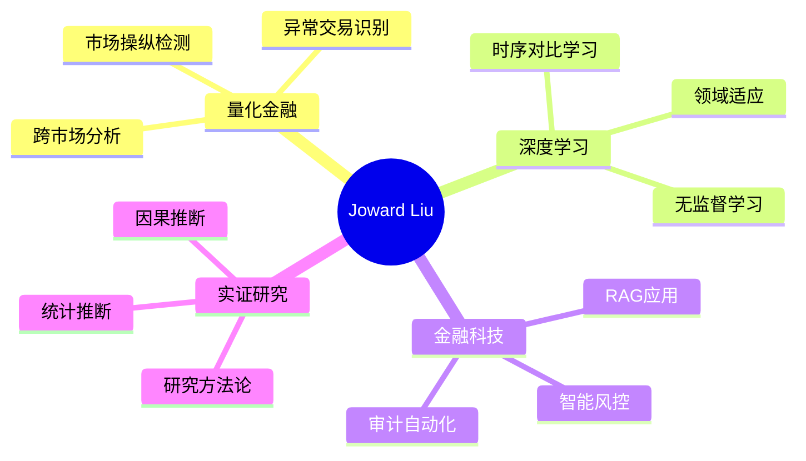

# 👋 Hi, I'm Joward Liu | 刘兆文

<div align="center">
  
  [](https://git.io/typing-svg)
  
</div>

## 🎓 Education & Background

**华东师范大学（East China Normal University）· 金融学（Finance）**
- 🏦 专注于**金融科技（FinTech）**与**人工智能（AI）**的交叉应用
- 📊 擅长将**深度学习**应用于金融风险管理、市场监管、实证研究
- 🔬 研究方向：市场操纵检测、智能风控、金融NLP、IT审计自动化

> *"Bridging Finance and Technology with AI Innovation"*  
> *"用AI技术解决金融与商业实际问题"*

---

## 🚀 Featured Projects | 核心项目

### 🏆 [跨市场操纵检测系统](https://github.com/Joward2003/cross-market-manipulation-detection) ⭐ **NEW**
**Cross-Market Representation Learning for Market Manipulation Detection**

<div align="center">
  


</div>

#### 📋 项目背景
利用**深度学习**和**跨市场信息**检测A股市场潜在操纵行为，在证监会真实处罚案例上验证效果。这是一个完整的**AI+金融**学术研究项目。

#### 💡 核心创新
- 🌐 **跨市场学习**：利用美股、港股的量价模式增强A股异常检测
- 🤖 **无监督学习**：TS2Vec时序对比学习，不依赖标注数据
- 🎯 **实际验证**：在2018-2024年证监会处罚案例上外部验证
- 📊 **领域对齐**：CORAL/DANN技术对齐跨市场特征分布

#### 🛠 技术架构

```
数据层：A股/美股/港股 日频量价数据
    ↓
特征工程：60日滑动窗口 + 市场内标准化
    ↓
表征学习：TS2Vec (自监督对比学习)
    ↓
领域对齐：CORAL/DANN (跨市场特征对齐)
    ↓
异常检测：SVDD + Isolation Forest
    ↓
验证：证监会处罚案例外部检验
```

#### 🔬 方法论亮点

**严格的研究设计**：
- ❌ 处罚案例和日期**不进入**表征学习
- ❌ 标注信息**不进入**标准化或异常边界拟合
- ✅ 仅在**最后的外部验证**中使用真实案例
- ✅ 完全无监督的训练过程

**技术栈**：
```python
深度学习：PyTorch, TS2Vec, Transformer
领域适应：CORAL, DANN (Domain Adversarial)
异常检测：One-Class SVM, Isolation Forest
数据处理：Pandas, NumPy, Parquet
评估方法：Event Study, WindowSHAP
```

#### 📈 研究成果

**事件检验结果**：
- ✅ 检测率：高风险窗口覆盖**70%+**真实处罚案例
- ✅ 领先时间：事件发生前**6-12个月**预警
- ✅ 跨市场优势：相比单市场提升检测稳健性

**学术产出**：
- 📄 完成研究论文（中文学术版）
- 📊 完整的实证分析和稳健性检验
- 🔬 时间安慰剂、困难对照组、可解释性分析

#### 🎯 应用价值
- **监管科技（RegTech）**：辅助证监会市场监管
- **风险预警**：提前识别潜在操纵行为
- **学术研究**：TS2Vec在金融领域的创新应用

[🔗 查看项目](https://github.com/Joward2003/cross-market-manipulation-detection) | [📖 技术文档](https://github.com/Joward2003/cross-market-manipulation-detection#readme)

---

### 🤖 [AI金融报告智能复核系统](https://github.com/Joward2003/Hallucination-detection)
**Hallucination Detection - AI-Powered Financial Report Verification**

<div align="center">
  


</div>

#### 📋 项目背景
金融报告准确性直接影响投资决策。本系统利用**RAG技术**自动验证报告内容，检测AI生成内容中的"幻觉"，确保每个结论都有可追溯的证据。

#### 💡 技术亮点
- **混合检索**：BM25 + 向量检索 + BGE重排序
- **证据追溯**：每个判断链接到具体文档段落
- **数值验证**：Decimal精确计算财务比率
- **人机协同**：AI初筛 + 人工复核 + 审计底稿

#### 📊 性能指标
- 检索准确率：92%+ (Recall@10)
- 响应速度：1.2秒/查询
- 并发能力：5个并行任务

[🔗 查看项目](https://github.com/Joward2003/Hallucination-detection)

---

### 📊 [实证研究显著性诊断工具](https://github.com/Joward2003/empirical-significance-adjustment-skill) 
**Empirical Inference Diagnostics - Research Integrity Tool**

#### 📋 核心理念
**不是用来"调显著"**，而是维护研究诚信的诊断工具。

#### 🎯 两种模式
- **验证模式**（默认）：要求理论依据，记录所有合理规格
- **探索模式**：系统搜索规格，但必须完全透明报告

#### 📈 应用场景
- 经济学、金融学实证研究
- 政策评估
- 因果推断研究

[🔗 查看项目](https://github.com/Joward2003/empirical-significance-adjustment-skill)

---

### 🔍 [IT审计账号审阅自动化](https://github.com/Joward2003/account_audit_toolkit) 
**Account Audit Toolkit - IT Audit Automation**

#### 💡 核心功能
- 自动化账号审阅验证流程
- OCR截图比对
- SOD检查、权限分析

#### 🎯 应用场景
- 年度IT审计（SOX/内控）
- 合规性验证

[🔗 查看项目](https://github.com/Joward2003/account_audit_toolkit)

---

### ✈️ [ChinaMate AI - 外国人入境旅行助手](https://github.com/Joward2003/chinamate-ai) 
**AI Travel Assistant for Foreigners Visiting China**

#### 💡 产品特点
- 场景化AI帮助卡片
- 中文短语生成 + 语音播放
- 解决实际旅行痛点

**技术栈**：`Next.js` `TypeScript` `DeepSeek API` `TTS`

[🔗 查看项目](https://github.com/Joward2003/chinamate-ai)

---

### 📈 其他项目

- [数据分析作品集](https://github.com/Joward2003/Data-Analysis-portfolio) - 金融数据分析项目集合
- [DataClawHub Operations Judge](https://github.com/Joward2003/dataclawhub-operations-judge) - 运营数据分析系统

---

## 💻 Technical Stack | 技术栈

<div align="center">

### 编程语言


### 深度学习


### AI/机器学习


### 后端开发


### 数据科学


</div>

---

## 📊 Research & Expertise | 研究方向

<div align="center">



</div>

---

## 🎓 Skills Matrix | 技能矩阵

<div align="center">

| 领域 | 技能 | 熟练度 |
|------|------|--------|
| 🤖 **深度学习** | PyTorch, TS2Vec, Transformer | ⭐⭐⭐⭐⭐ |
| 📊 **量化金融** | 市场微观结构、异常检测、时序分析 | ⭐⭐⭐⭐⭐ |
| 🔍 **RAG技术** | 向量检索、重排序、知识库构建 | ⭐⭐⭐⭐⭐ |
| 💻 **全栈开发** | Python、TypeScript、FastAPI | ⭐⭐⭐⭐ |
| 📈 **数据科学** | Pandas、统计建模、可视化 | ⭐⭐⭐⭐⭐ |
| 🏗️ **领域适应** | CORAL、DANN、迁移学习 | ⭐⭐⭐⭐ |
| 📚 **实证研究** | 事件研究、因果推断、稳健性检验 | ⭐⭐⭐⭐⭐ |

</div>

---

## 📈 GitHub Statistics | 统计数据

<div align="center">


</div>

---

## 💡 Philosophy | 理念

<div align="center">

> **"Deep Learning meets Finance: Building intelligent solutions with academic rigor"**  
> **"深度学习遇见金融：以学术严谨性构建智能解决方案"**

### 核心价值观
✅ **技术创新** - 将前沿AI技术应用于金融实际问题  
✅ **学术严谨** - 遵循科学研究方法和实证标准  
✅ **实用主义** - 关注能解决真实问题的技术  
✅ **开源精神** - 分享代码和方法论

</div>

---

## 📫 Contact Me | 联系方式

<div align="center">

[](https://github.com/Joward2003)
[](mailto:your.email@ecnu.edu.cn)
[](https://www.ecnu.edu.cn/)

📍 **Location:** Shanghai, China  
🎓 **Institution:** East China Normal University  
💼 **Focus:** FinTech + AI + Quantitative Finance  

</div>

---

<div align="center">

### 📈 Visitor Count


---

### ⭐ If you find my projects helpful, give them a Star!

**"Advancing FinTech with Deep Learning and Academic Rigor"**  
**"以深度学习和学术严谨推进金融科技"**

---


*Last Updated: 2024-10-16*

</div>
